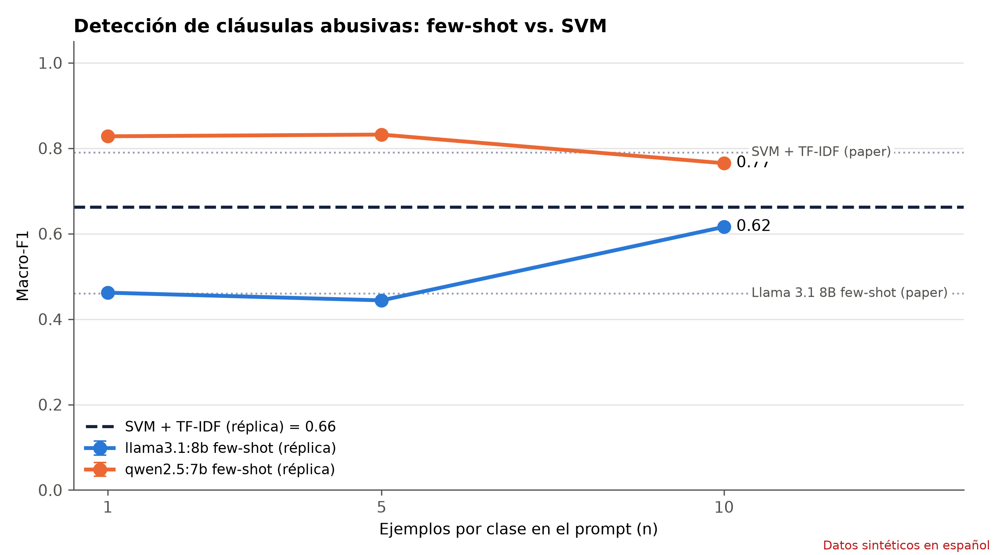
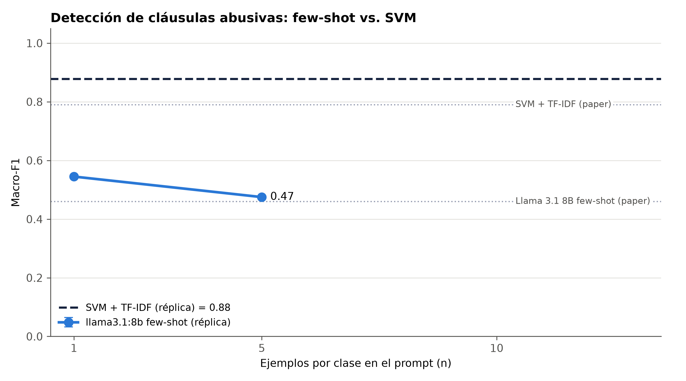

# Réplica: detección de cláusulas abusivas en español con LLM

Réplica de **Löffler, C., Martínez Freile, A., & Rey Pizarro, T. (2025). Predicting potentially abusive
clauses in Chilean terms of services with natural language processing.** *Artificial Intelligence and Law*.
https://doi.org/10.1007/s10506-025-09462-w (preprint: arXiv 2502.00865)

Autor: Darihl Piero Valentin Palomino · Propuesta de Investigación 2026-2 · Universidad de Lima


## Qué se replica

| Elemento | Paper original | Esta réplica |
|---|---|---|
| Datos | 50 ToS chilenos, 5.209 cláusulas reales, ~20 % abusivas (no publicado) | 1.000 cláusulas **sintéticas realistas en español** (`generar_sinteticos.py`) y, como control, 200 cláusulas **reales** en inglés de UNFAIR-ToS (LexGLUE) |
| Esquema | 20 clases (ilegales, oscuras, grises) | Las 6 **cláusulas oscuras** (Art. 16 LPC): cr, ter, ch, er, ltd, nod |
| Tareas | Detección y clasificación | Detección (*Dark Detection*) y clasificación multietiqueta (*Dark Classification*) |
| Partición | 70/30 entrenamiento-prueba; el 70 % otra vez 70/30 en entrenamiento-validación, estratificada | Igual: 490 entrenamiento, 210 validación, 300 prueba |
| Supervisado | SVM + TF-IDF (n-gramas 1-3) y transformers ajustados (BERT, BETO, XLM-R) | SVM + TF-IDF (n-gramas 1-3) |
| Few-shot | GPT-4o, Llama 3.1 8B, Qwen2.5 7B, Gemma2 y otros; n = 1, 5, 10 | **Llama 3.1 8B y Qwen2.5 7B vía Ollama**, n = 1, 5, 10, mismo prompt traducido y muestreo representativo por longitud, temperatura 0 |
| Métricas | µ-F1 y macro-F1 | Igual |

**Datos sintéticos realistas.** Las cláusulas imitan la redacción de contratos reales. Las abusivas son
sutiles y las justas usan el mismo vocabulario (modificar, suspender, responsabilidad): la diferencia
está en si el cliente puede rechazar un cambio, si tiene un plazo razonable o quién asume un error, no en
una frase delatora. La mitad de las cláusulas de prueba usa redacciones que no aparecen en entrenamiento,
para medir generalización y no memoria.

## Experimentación: resultados

Detección de cláusulas abusivas (macro-F1). Una semilla por configuración.

| Modelo | n | Sintéticos realistas (300) | Reales, LexGLUE (200) | Paper (Tabla 5) |
|---|---|---|---|---|
| SVM + TF-IDF | — | 0.66 | 0.88 | 0.79 |
| Llama 3.1 8B | 1 | **0.46** | 0.55 | **0.46** |
| Llama 3.1 8B | 5 | 0.44 | 0.48 | — |
| Llama 3.1 8B | 10 | 0.62 | — | — |
| Qwen 2.5 7B | 1 | 0.83 | — | — |
| Qwen 2.5 7B | 5 | 0.83 | — | — |
| Qwen 2.5 7B | 10 | 0.77 | — | — |

El paper reporta un solo valor por modelo en detección; el número de ejemplos usado no se indica.
Clasificación del tipo de cláusula con SVM (datos sintéticos): macro-F1 0.49.




**Hallazgos**

1. **El SVM supera a Llama 3.1 8B en few-shot**, como en el paper, tanto con datos sintéticos como reales.
2. **Llama 3.1 8B con un ejemplo saca 0.46**, el mismo valor del paper. Con 5 ejemplos responde
   "no abusiva" a casi todo: el micro-F1 se ve alto, pero el macro-F1 cae.
3. **Qwen 2.5 7B llega a 0.83** y supera al SVM en los datos sintéticos. El paper no lo evaluó en
   detección, así que no hay referencia directa.
4. Con datos reales el SVM alcanza 0.88, cerca del 0.79 del paper; con los sintéticos baja a 0.66 porque
   abusivas y justas comparten vocabulario y TF-IDF se guía por palabras.

Detalle completo: `resultados/resumen.csv` y `resultados/referencia_paper.csv`.

## Instalación (Windows)

```
python -m venv .venv
.venv\Scripts\activate
pip install -r requirements.txt
ollama pull llama3.1:8b
ollama pull qwen2.5:7b
```

## Ejecución

```
python generar_sinteticos.py
python experimento.py --metodo svm --tarea deteccion
python experimento.py --metodo svm --tarea clasificacion
python experimento.py --metodo llm --modelo llama3.1:8b --tarea deteccion --n 1 5 10 --semillas 1
python experimento.py --metodo llm --modelo qwen2.5:7b  --tarea deteccion --n 1 5 10 --semillas 1
python experimento.py --metodo svm --tarea deteccion --fuente lexglue --limite 200
python experimento.py --metodo llm --modelo llama3.1:8b --tarea deteccion --fuente lexglue --n 1 5 --semillas 1 --limite 200
python evaluar.py
python graficos.py
python graficos.py lexglue
streamlit run app.py
```

- En una RTX 4060, cada valor de n con 300 cláusulas tarda entre 12 y 33 minutos (n = 10 es el más lento).
- Prueba rápida: agrega `--limite 20 --semillas 1` a un comando de LLM (y luego borra ese JSON de `resultados/`).
- Sin GPU ni Ollama: `--modelo simulado` (respuestas falsas, solo para probar el flujo).
- Datos propios: `--fuente csv --csv data/mis_clausulas.csv` con columnas `texto`, `etiquetas` (p. ej. `ter;ltd`, vacío si es justa) y `split` (`train`, `val`, `test`).

## Probar sin instalar nada (GitHub Codespaces)

En este repositorio: **Code → Codespaces → Create codespace on main**. En la terminal:

```
pip install -r requirements.txt
streamlit run app.py
```

Abre el puerto 8501 y elige **«ninguno (solo SVM)»**: el Codespace no tiene GPU, así que los LLM no
corren ahí; sus resultados están en `resultados/` y `figuras/`.

## Limitaciones

- El corpus chileno no es público: los datos sintéticos no permiten comparar cifras uno a uno con el
  paper; se comparan los hallazgos. UNFAIR-ToS es real pero está en inglés y tiene otras categorías.
- Una sola semilla por configuración y 200-300 cláusulas de prueba: las diferencias pequeñas no son
  concluyentes.
- Modelos cuantizados de Ollama (4 bits por defecto).
- No se replica el ajuste fino de transformers (BETO, XLM-R); en la tesis se hará con QLoRA sobre
  Llama 3.1 8B y Qwen.
