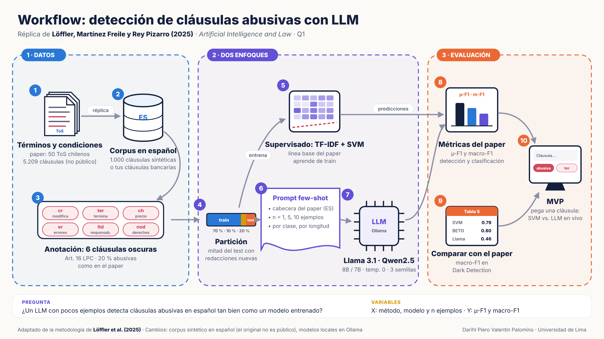

# Réplica: detección de cláusulas abusivas en español con LLM

Réplica de **Löffler, C., Martínez Freile, A., & Rey Pizarro, T. (2025). Predicting potentially abusive
clauses in Chilean terms of services with natural language processing.** *Artificial Intelligence and Law*.
https://doi.org/10.1007/s10506-025-09462-w (preprint: arXiv 2502.00865)

Autor: Darihl Piero Valentin Palomino · Propuesta de Investigación 2026-2 · Universidad de Lima



## Qué se replica

| Elemento | Paper original | Esta réplica |
|---|---|---|
| Datos | 50 ToS chilenos, 5.209 cláusulas, ~20 % abusivas (no publicado) | 1.000 cláusulas **sintéticas en español** con la misma proporción (`generar_sinteticos.py`), o un CSV propio (p. ej. cláusulas de banca peruana) |
| Esquema | 20 clases (ilegales, oscuras, grises) | Las 6 **cláusulas oscuras** (Art. 16 LPC): cr, ter, ch, er, ltd, nod |
| Tareas | Detección y clasificación | Detección (*Dark Detection*) y clasificación multietiqueta (*Dark Classification*) |
| Supervisado | SVM + TF-IDF y transformers ajustados (BERT, BETO, XLM-R) | SVM + TF-IDF |
| Few-shot | GPT-4o, Llama 3.1 8B, Qwen2.5, Gemma2 (vía Ollama), n = 1, 5, 10 | **Llama 3.1 8B y Qwen2.5 7B vía Ollama**, n = 1, 5, 10, mismo prompt traducido y muestreo representativo por longitud |
| Métricas | µ-F1 y macro-F1, 3 semillas | Igual |

La mitad de las cláusulas de prueba usa redacciones que no aparecen en entrenamiento, para medir
generalización y no memoria.

## Instalación (Windows)

```
python -m venv .venv
.venv\Scripts\activate
pip install -r requirements.txt
ollama pull llama3.1:8b
ollama pull qwen2.5:7b
```

## Ejecución

```
python generar_sinteticos.py
python experimento.py --metodo svm --tarea deteccion
python experimento.py --metodo svm --tarea clasificacion
python experimento.py --metodo llm --modelo llama3.1:8b --tarea deteccion --n 1 5 10 --semillas 3
python experimento.py --metodo llm --modelo qwen2.5:7b  --tarea deteccion --n 1 5 10 --semillas 3
python experimento.py --metodo llm --modelo llama3.1:8b --tarea clasificacion --n 1 5 10 --semillas 3
python experimento.py --metodo llm --modelo qwen2.5:7b  --tarea clasificacion --n 1 5 10 --semillas 3
python evaluar.py
python graficos.py
streamlit run app.py
```

- Prueba rápida antes de todo: agrega `--limite 20 --semillas 1` a un comando de LLM (y luego borra ese JSON de `resultados/`).
- Sin tiempo: usa `--semillas 1`.
- Sin GPU ni Ollama: `--modelo simulado` (respuestas falsas, solo para probar el flujo).
- Datos propios: `--fuente csv --csv data/mis_clausulas.csv` con columnas `texto`, `etiquetas` (p. ej. `ter;ltd`, vacío si es justa) y `split` (`train`, `val`, `test`).
- Datos reales en inglés (CLAUDETTE / LexGLUE, solo detección): `--fuente lexglue`.

## Exponer desde otra computadora (sin GPU ni Ollama)

1. En tu PC con GPU corre los experimentos y sube a GitHub la carpeta completa, **incluida `resultados/` y `figuras/`**.
2. En la otra computadora: `git clone <tu-repo>`, crea el entorno e instala `requirements.txt`.
3. `streamlit run app.py` y elige **«ninguno (solo SVM)»**: el SVM funciona sin LLM.
4. Para mostrar el LLM en acción, usa un video grabado en tu PC (Windows: tecla Windows + Alt + R).

## Resultados

`resultados/resumen.csv` (media y desviación por semilla), `resultados/referencia_paper.csv`
(Tabla 5, Dark Detection) y `figuras/sintetico_deteccion.png`, `figuras/sintetico_clasificacion.png`.

## Limitaciones

- El corpus chileno no es público: se usan datos sintéticos, por lo que las cifras no son comparables
  uno a uno con el paper; se compara la tendencia (supervisado vs. few-shot, efecto de n).
- Modelos cuantizados de Ollama (4 bits por defecto; el paper usó 8 bits).
- No se replica el ajuste fino de transformers (BETO, XLM-R); es el siguiente paso, y en la tesis se
  hará con QLoRA sobre Llama 3.1 8B.
